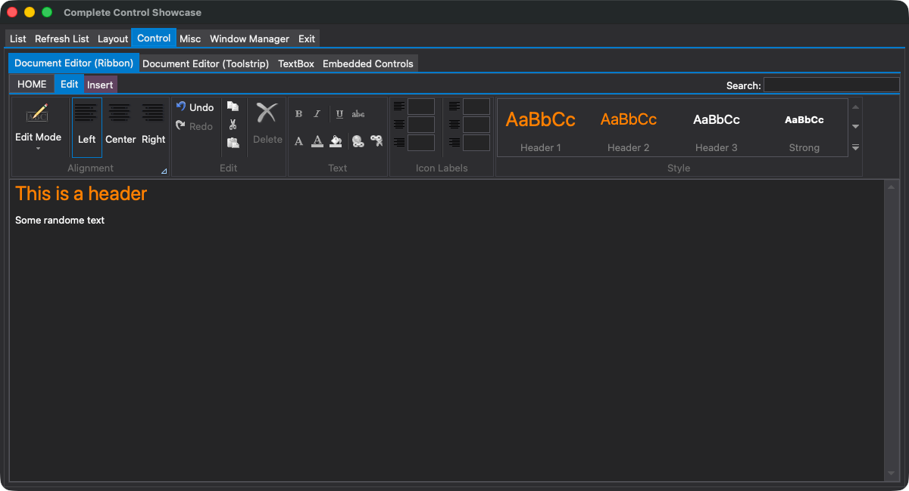

# iGac — macOS Port of GacUI

macOS implementation of [GacUI](http://www.gaclib.net) using Cocoa and CoreGraphics/Quartz2D.

## License

**Read the [LICENSE](https://github.com/vczh-libraries/iGac/blob/master/LICENSE.md) first.**

## Maintenance Prerequisite

This repo is stand alone, all dependencies are in the repo for building.

To run `RemotingTest_Rendering_macOS` by `test.sh --app:renderer`, the `GacUI` repo is needed. `test_core.sh` full-builds and runs the matching project under `GacUI/Test/Linux`.

For developers maintaining this repo, run `./syncOrg.sh`, or clone the upstream repositories beside this repository. iGac reads framework imports, release sources, test resources, generated-code metadata, and the Knowledge Base directly from `../GacUI`; `import.sh` to take latest code from `GacUI/(Import|Release)` to `Import`; `syncProj.sh` also builds Workflow's `CppMerge` from `../Workflow`. The `Release` repository is not an iGac maintenance dependency. The importer normalizes each snapshot file to its existing line-ending convention so CodePack and Git checkout conversions do not cause unrelated changes.

## Supported Platforms

- Windows implementation is released in [the Release repo](https://github.com/vczh-libraries/Release)
- Linux implementation is released in [the wGac repo](https://github.com/vczh-libraries/wGac)
- macOS implementation is released in [the iGac repo](https://github.com/vczh-libraries/iGac)
- HTML5 implementation is released in [the GacJS repo](https://github.com/vczh-libraries/GacJS)



.png)

### Install Homebrew and Development Tools

Install Apple's Command Line Tools if they are not already installed:

```bash
xcode-select --install
```

Install Homebrew with the command from the [official Homebrew installation page](https://brew.sh/):

```bash
/bin/bash -c "$(curl -fsSL https://raw.githubusercontent.com/Homebrew/install/HEAD/install.sh)"
```

Follow the installer's **Next steps** to add Homebrew to your shell environment,
then run this command from the repository root:

```bash
brew update
brew bundle
```

`brew bundle` installs the tools declared in [`Brewfile`](Brewfile):

| Brewfile entry | Purpose |
| --- | --- |
| `cmake` | Configures the native build. This project requires CMake 3.20 or newer. |
| `coreutils` | Provides `grealpath`, used by the upstream helper build scripts invoked during synchronization. |
| `node` | Installs Node.js and its bundled `npm` for JavaScript tooling. The native CMake build does not invoke them. |
| `visual-studio-code` | Installs Visual Studio Code as an optional development editor; it is not required by the build or test scripts. |

Apple's Command Line Tools provide `clang++`, `lldb`, `make`, `git`, and the
macOS SDK and frameworks. No separate Homebrew LLVM or Git installation is
needed. The helper scripts call Coreutils' `grealpath` name explicitly, so its
`gnubin` directory does not need to be added to `PATH`.
Synchronization also requires `perl` for imported-source line endings; install it
with `brew install perl` if it is unavailable.

To update Homebrew and these tools later:

```bash
brew update
brew bundle
```

See Homebrew's [package update instructions](https://docs.brew.sh/FAQ#how-do-i-update-my-local-packages) for upgrading all installed packages instead.

## Project Structure

```
iGac/
├── Brewfile                   Homebrew formulae and development-tool casks
├── Mac/                        macOS platform implementation
│   ├── NativeWindow/OSX/       Cocoa windowing (controller, window, view, input)
│   │   ├── ServicesImpl/       Service implementations (screen, clipboard, dialog, ...)
│   │   └── CoreGraphics/       CoreGraphics app entry point
│   └── GraphicsElement/
│       └── CoreGraphics/       CoreGraphics rendering engine (renderers, layout, resource manager)
│
├── MacShared/                  Shared static libraries and test utilities
│   ├── CMakeLists.txt          Builds GacUI, GacOSX, GacOSXShared static libraries
│   ├── gac_include.h           Convenience header: includes GacUI, registers DarkSkin theme
│   ├── FullControlTestRawElement* Cocoa clock and remote collection attachments for test apps
│   ├── osx_shared.h/mm         OS X helpers (string conversion, file utils, resource folder)
│   └── UnixFileSystemInfo.*    Cross-platform file system utilities
│
├── MacTest/                    Hello World, Raw element and hosted modal tests
│   ├── CMakeLists.txt
│   ├── HelloWorlds/Cpp/Main.cpp
│   ├── RawElement.cpp          Focused Cocoa raw-element and remote-lifecycle tests
│   └── HostedModal.cpp         Nested modal timer/input regression
│
├── MacFullControlTest/         Full-featured test app using BlackSkin control template
│   ├── CMakeLists.txt
│   └── Main.mm
├── MacTuiControlTest/          Foreground terminal showcase using TuiSkin
├── MacCppTestRvm/              Hosted Remote View Model Test client
├── RemotingTest_Rendering_macOS/ Native `/MiniHttp` renderer for GacUI's RemotingTest_Core
│
├── Apps/                       Upstream test resources and merged x32/x64 C++
│   ├── FullControlTest/
│   │   ├── Resources/          Copied from ../GacUI/Test/Resources/App
│   │   └── Source/             Merged by GacBuild, including embedded resources
│   ├── RemoteProtocolTest/
│   │   ├── Resources/
│   │   └── Source/
│   ├── TuiControlTest/         Synchronized TUI resources and merged x32/x64 C++
│   └── RemoteViewModelTest/
│       ├── Resources/
│       └── Source/
│
├── Import/                     Amalgamated GacUI source files (Vlpp, GacUI, Workflow, ...)
├── Import-Test/                Test-only GacUI remoting helper amalgamations
├── Screenshots/                Native FCT and terminal showcase captures for every color theme
│
├── doc/                        Documentation
│   ├── OSProvider.md           macOS OS provider: controller, services, entry point
│   ├── OSProvider_Window.md    macOS OS provider: INativeWindow, CocoaWindow, popups
│   ├── OSProvider_Graphics.md  macOS OS provider: CoreGraphics rendering, elements, fonts
│   ├── OSProvider_HostedMode.md macOS hosted mode: virtual windows, render lifecycle
│   └── lldb.md                 Direct LLDB debugging and launch validation
│
├── CMakeLists.txt              Root CMake config (project GacOSX, C++23)
├── import.sh                   Refresh Import/ from the sibling GacUI repository
├── GacBuild.sh                 Run upstream generators with full metadata
├── syncOrg.sh                  Clone and synchronize sibling organization repositories
├── syncProj.sh                 Sync test resources and merge x32/x64 C++ sources
├── build.sh                    Build script (incremental by default, --rebuild for clean)
├── test.sh                     Run native test apps or the native remote renderer
└── test_core.sh                Full-build and run a sibling GacUI Core-side test
```

The generated `Import/`, `Import-Test/`, and `Apps/` snapshots are committed so a normal iGac build does not require code generation. Run the synchronization scripts when updating upstream dependencies or test resources.

## Synchronizing Organization Repositories

```bash
./syncOrg.sh
```

This synchronizes the `Vlpp`, `VlppOS`, `VlppRegex`, `VlppReflection`,
`VlppParser2`, `Workflow`, `GacUI`, `GacJS`, `Release`, `Tools`, `wGac`, and
`iGac` repositories, including the repository containing the script itself.
Missing repositories are cloned from the `vczh-libraries` GitHub organization.
Existing repositories are updated only when they are on `master` with no
uncommitted tracked files, untracked files, or unpushed commits. A repository
that fails any check is reported in red and skipped while the script continues
with the remaining repositories.

## Refreshing GacUI Imports

```bash
./import.sh
```

This removes and recreates `Import/` and `Import-Test/`, copies dependency amalgamations from `../GacUI/Import/`, adds the ordinary GacUI amalgamations from `../GacUI/Release/`, places the DarkSkin and TuiSkin release files under `Import/Skins/DarkSkin/` and `Import/Skins/TuiSkin/`, and moves the neutral `Test.RemotingHelpers` pair into `Import-Test/`. The test-only stdio transport and its platform implementation come from the imported `VlppOS` release files. Both snapshots remain writable so Git and repeated imports can replace their contents without permission failures. Treat `Import/` and `Import-Test/` as generated snapshots: compatibility fixes belong in this repository's CMake or macOS integration code. These helpers are only for platform test targets and are not part of the ordinary framework snapshot. Review and commit the vendor update together with those integration changes.

## Synchronizing Test Projects

```bash
./syncProj.sh
```

This incrementally builds `<Workflow repo>/Tools/CppMerge`, `<GacUI repo>/Tools/GacGen`
and `<GacUI repo>/Tools/GacBuild` through their existing native build helpers. It copies
the `FullControlTest`, `RemoteProtocolTest`, `RemoteViewModelTest` and `TuiControlTest`
resource trees and their seed C++ files from `<GacUI repo>/Test/Resources/App/`, then
invokes `<iGac repo>/GacBuild.sh -mode:GacGen` for each resource. GacGen stages
`/P32` and `/P64`; GacBuild validates both outputs and uses CppMerge to merge matching files into
`<iGac repo>/Apps/*/Source/`, preserving upstream seed `USER_CONTENT`, embedded
resources and `RemoteViewModelTestRpc.h/.cpp`.

`GacBuild.sh` locates all three executables in the sibling GacUI and Workflow
repositories and supplies explicit absolute paths to GacGen and CppMerge. It passes a
temporary GacGen symlink without resolving it, so the adjacent `Metadata.txt`
selects full `Reflection32.bin` and `Reflection64.bin` from
`<GacUI repo>/Test/Resources/Metadata/`. Full metadata includes generated dialog
types absent from the development tool's usual core-only metadata. The wrapper
removes its temporary entry point on success or failure and returns the native
tool's exit status. Maintenance uses the sibling Workflow and GacUI repositories;
it does not require a Release checkout.

Synchronization adds the imported skin headers to each showcase's generated C++ includes: TuiSkin for TuiControlTest and DarkSkin for FullControlTest. FullControlTest's vertical tab rail uses DarkSkin templates and palette values directly.

After `syncProj.sh` builds the tools, the wrapper can also be used directly:

```bash
./GacBuild.sh -FileName path/to/GacUI.xml -Dump
./GacBuild.sh -mode:GacGen -FileName Apps/TuiControlTest/Resources/Resource.xml
```

The default GacBuild mode takes a driver XML for incremental resource discovery;
`-Dump` only reports the plan. Put `-mode:GacGen` first to rebuild one resource,
optionally with `-MappingFileName <mapping>`. XML and mapping paths remain relative
to the caller's working directory, even when invoking the wrapper from elsewhere.

Inspect `<iGac repo>/Apps/*/Resources/GacBuild.log` and
`<iGac repo>/Apps/*/Resources/Resource.xml.log/{x32,x64}/` for orchestration and compiler
diagnostics, staged C++/RPC files, binary caches and `Deploy.xml` deployment lists.
Staging artifacts are retained after success or failure and ignored by Git; the
next synchronization replaces the copied resource trees. Generation,
missing-artifact, merge and deployment failures stop synchronization with nonzero status.

The script also copies the shared `FullControlTestEventHandlers.h/.cpp` handler from
`<GacUI repo>/Test/GacUISrc/Generated_FullControlTest/`; the local Full Control Test entry
point attaches it so every Color Theme preset refreshes existing controls in
both standard and hosted mode. It also refreshes the shared native-renderer and RVM entry points,
the RVM initializer, and `<GacUI repo>/Test/GacUISrc/CppTest_Tui/Main.cpp` as `<iGac repo>/MacTuiControlTest/GuiMain.cpp`.
The RVM entry point's shared automation argument header is copied to the committed
root `<iGac repo>/SharedArguments.h`, so a fresh clone can build without sibling sources or
temporary files. Only the terminal platform entry point remains local. MiniHTTP automation is part of the imported GacUI
snapshot, while reusable test remoting helpers come from `<iGac repo>/Import-Test/`;
neither is maintained as a local `<iGac repo>/MacShared/Mini*.cpp` copy. Generated
reflection files are retained in `<iGac repo>/Apps/*/Source/`, but test targets compile with
`VCZH_DEBUG_NO_REFLECTION` and do not include them.

The clock helpers remain macOS-owned under `<iGac repo>/MacShared`; synchronization
does not copy the Windows clock helpers. The local FCT and native remote renderer
compile the Cocoa helpers directly, while `GacOSX` supplies the reusable
`GuiCocoaElement` from `<iGac repo>/Mac/GraphicsElement/CoreGraphics`.
The shared renderer entry point's macOS attachment hook is maintained upstream
and survives synchronization. `<Raw/>` creates this element in ordinary,
hosted and native remote modes. See [the drawing contract](doc/OSProvider_Graphics.md#raw-cocoa-drawing)
for callback lifetime, clipping and received clock data.

Use `<Raw/>` as the standard, recommended owner-drawing element for local and
remote graphical applications. XML provides `Id` and `Data` through
`GuiRawElementBase`; C++ subscribes to `GuiCocoaElement::Rendering` to draw with
the callback's borrowed `CGContextRef`. The Core sends drawing state to remote
clients, whose platform or browser code performs the drawing. Supply a useful
composition size and retain/detach drawing handlers with their owner. TUI does
not support `<Raw/>`.

Each generated application also has an embedded-resource `.cpp` file. Full Control Test links `FullControlTestResource.cpp`, whose plugin loads the resource from compiled data; no `.bin` file is bundled or located at runtime.

## Building

```bash
./build.sh              # Incremental build
./build.sh --rebuild    # Clean build (git clean -Xdf + full rebuild)
```

Build output goes to `build/`. The build system requires CMake 3.20 or newer and uses C++23.

The official build also produces Raw element and hosted modal regression tests.
Run these after `./build.sh`:

```bash
./build/MacTest/bin/Test_RawElement /C
./build/MacTest/bin/Test_RawElement /C --hosted
./build/MacTest/bin/Test_HostedModal /C
```

The modal test opens two dialogs from queued application work and requires
continued timer delivery, queued dismissal and normal shutdown.

For runtime clock verification, open Misc / Raw Clock in local FCT, repeat with
`--hosted`, and repeat through `test_core.sh --app:fct --protocol:minihttp` plus
`test.sh --app:renderer`. Verify ticking without input, resizing, tab return,
palette refresh and renderer replacement/takeover. The clock paints received
data; it has no renderer-local timer. Results belong in
`<iGac repo>/TestMatrix_NativeRenderer.md`.

iGac does not support native touch experience. The synchronized FullControlTest
includes Touching and TouchingList, but native touch acquisition and gesture
checks are excluded. Existing empty point-listener callbacks satisfy the native
interface; Cocoa point automation reports that input is unsupported. Raw Clock
and ordinary mouse, wheel and keyboard verification remain required. This
exclusion does not apply to GacJS browser touch on macOS. See
[native touch applicability](doc/OSProvider_Window.md#native-touch-applicability).

### Static Libraries

- **GacUI** — Core GacUI amalgamated sources (Vlpp, VlppOS, VlppRegex, VlppReflection, VlppGlrParser, VlppWorkflowLibrary, GacUI, DarkSkin)
- **GacOSX** — All macOS platform code (Cocoa windowing, CoreGraphics rendering, services)
- **GacOSXTui** — Terminal adapter in `Mac/TUI`, built by `MacTuiControlTest/CMakeLists.txt`; reuses Cocoa services and the portable TUI provider
- **GacOSXShared** — Imported remoting test helpers plus shared macOS test utilities (osx_shared, UnixFileSystemInfo)

Code is compiled with `VCZH_DEBUG_NO_REFLECTION`. If reflection is needed, remove this define from `MacShared/CMakeLists.txt` and add all reflection `.cpp` files.

## Running

```bash
./test.sh --app:simple                         # Run Hello World
./test.sh --app:simple --unblock               # Run Hello World in background
./test.sh --app:fct                            # Run Full Control Test
./test.sh --app:fct --hosted                   # Run Full Control Test in hosted mode
./test.sh --app:fct --hosted --unblock         # Combine hosted and background modes
./test.sh --app:tui                            # Run the terminal showcase in the foreground
./test.sh --app:rvmt                           # Run the hosted Remote View Model Test client
./test.sh --app:rvmt --unblock                 # Start the RVM client and print its PID
./test.sh --app:renderer                       # Connect to RemotingTest_Core with /MiniHttp
./test.sh --app:renderer --port:8890           # Start a takeover renderer on automation port 8890
./test.sh --app:renderer --unblock             # Start the renderer and print its PID
./test_core.sh --app:cpptest_rvm --protocol:minihttp --unblock
./test_core.sh --app:fct --protocol:minihttp
./test_core.sh --app:rpt --protocol:minihttp
./test_core.sh --app:rvmt --protocol:minihttp [--cli]
```

`--app:tui` runs `build/MacTuiControlTest/bin/Test_TuiControlTest` with inherited terminal input/output. It rejects `--unblock`, `--hosted`, and `--port`. No `.app` bundle, Cocoa window, automation endpoint, Core or renderer is involved. The adapter uses TuiControllerBase, Cocoa pasteboard/image services and Carbon global shortcuts; its TUI timer pumps platform events on the application thread. See [the terminal SOP](../GacUI/.github/Jobs/DebugTuiControlTestSop.md) and [TestMatrix_Tui.md](TestMatrix_Tui.md) for supported input and verification results.

`--unblock` starts the selected executable in the background and prints its
PID. `--hosted` is valid only with `--app:fct`. `--port:<1-65535>` is valid
only with `--app:renderer` and selects that renderer's automation listener; it
does not change the `/MiniHttp` Core connection on port 8888. The default
renderer automation port is 8889.

`test_core.sh` follows the same `--app:` and `--unblock` spelling and requires
`--protocol:minihttp`, the only portable transport. It calls GacUI's
`Test/Linux` build helper with `-f` before starting each used GacUI project.
For manual `cpptest_rvm` and `rvmt` modes it starts the requester/Core first,
waits one second, then full-builds and starts `RemotingTest_RvmHost`; an
unblocked manual run prints both PIDs. `--cli` is supported by `--app:rvmt`,
prebuilds the host, and lets Core auto-launch it over stdio. Portable
`Test_CppTest_Rvm` remains manual `/MiniHttp` only.

The native GUI test applications own a mode-specific Cocoa automation service and a
MiniHTTP endpoint. Append `/Controls` for control-tree applications, `/Dom`
for the native renderer, or `/IO` for input:

| Test application | Automation service | Endpoint base |
| --- | --- | --- |
| Simple | `CocoaAutomationService` | `http://127.0.0.1:8888/Automation/Test_HellWorld_Cpp` |
| Full Control Test | `CocoaAutomationService` or `CocoaAutomationServiceHosted` | `http://127.0.0.1:8888/Automation/Test_FullControlTest` |
| Remote View Model Test | `CocoaAutomationServiceHosted` | `http://127.0.0.1:8888/Automation/CppTest_Rvm` |
| Native remote renderer | `CocoaAutomationServiceRenderer` | `http://127.0.0.1:<renderer-port>/Automation/RemotingTest_Rendering_Native` |

`--app:rvmt` waits for the matching Workflow RPC host. Start the client first,
then run:

```bash
../GacUI/Test/Linux/RemotingTest_RvmHost/Bin/RemotingTest_RvmHost /MiniHttp
```

The RVM client exposes its control tree after the host connects.

For the native renderer, start
`GacUI/Test/Linux/RemotingTest_Core/Bin/RemotingTest_Core /MiniHttp /RPT`
(or use `./test_core.sh --app:rpt --protocol:minihttp`) before
`./test.sh --app:renderer`. The renderer exposes its DOM and
renderer-side IO on its selected automation port. A replacement can reuse 8889
after the old renderer stops; for live takeover, keep the old renderer on 8889
and start the new one with `--port:8890`.

Follow [GacUI's native-renderer verification guide](../GacUI/.github/Jobs/DebugRemoteProtocolWithNativeRenderer.md) for the complete RPT/FCT, replacement, takeover, and cleanup workflow.

## Documentation

[`Screenshots/`](Screenshots/) contains all six Full Control Test themes and all six TUI themes, captured with their native macOS window frames. Refresh them using the [screenshot update job](../GacUI/.github/Jobs/job.updateScreenshots.prompt.md).

- [TestMatrix_Tui.md](TestMatrix_Tui.md) — macOS terminal showcase verification and host limitations.

- [doc/OSProvider.md](doc/OSProvider.md) — Controller, services, entry point, and overall architecture of the macOS platform layer.
- [doc/OSProvider_Window.md](doc/OSProvider_Window.md) — INativeWindow implementation (CocoaWindow): window lifecycle, Show/Hide, popups, child windows, custom frame, key differences from Windows.
- [doc/OSProvider_Graphics.md](doc/OSProvider_Graphics.md) — CoreGraphics rendering backend: render targets, element renderers, text layout, font management.
- [doc/OSProvider_HostedMode.md](doc/OSProvider_HostedMode.md) — Hosted mode: single-window rendering, hosted controller, virtual windows, render target lifecycle.
- [doc/lldb.md](doc/lldb.md) — Direct LLDB command-line debugging and launch-validation workflow.

## TODO

- `IGuiGraphicsParagraph`
  - Need to test inserting image.
  - Test CocoaClipboardService when image is tested.

## Known Issues

- TUI local shortcuts involving Alt/Command do not work correctly in the tested legacy Terminal.app profile; use Kitty for these shortcuts. Terminal.app 2.15 with the Basic profile drops Alt from `Ctrl+Alt+Q` and sends nothing for `Ctrl+Alt+Command+Q`. Kitty can preserve these modifiers through its extended keyboard protocol. OS-registered global shortcuts still work through Carbon because they bypass terminal input. Terminal or macOS shortcut bindings can still intercept a chord; other terminals with compatible keyboard-protocol support may also work.
- VKEY mapping is quite big, should be shorter
- Not Implemented:
  - `AsyncService::Semaphore::WaitForTime`
  - `CocoaWindow::GetIcon` and `SetIcon`

## Planning

- Replace CGLayer with Metal for rendering
## Remote feature options and document files

The native renderer and portable core demo default to no feature injection. Pass
`/remoteDT`, `/remoteLocale` and `/remoteFS` independently to both processes, for
example `./test_core.sh --app:fct --protocol:minihttp -remoteDT -remoteLocale -remoteFS`
and `./test.sh --app:renderer -remoteDT -remoteLocale -remoteFS`. The shell translates single-dash options to slash switches, which are forwarded in foreground and `--unblock` modes. Renderer capabilities are
reevaluated after replacement. Missing DateTime/Locale capabilities use the core
predecessor; an enabled filesystem without renderer support exposes an empty `/`
root and never accesses core files.

`FullControlTestEventHandlers.h/.cpp` replaces `FullControlTestPalette.h/.cpp` in
the synchronized FullControlTest sources. The local entry point attaches the palette
handler and all four persistence events to each editor's own document viewer.
Private `.bin` files contain their image bytes; private save and RTF/HTML exports
complete synchronously, including remote stream close. Synchronize the framework,
resources and shared sources together after this protocol change.
